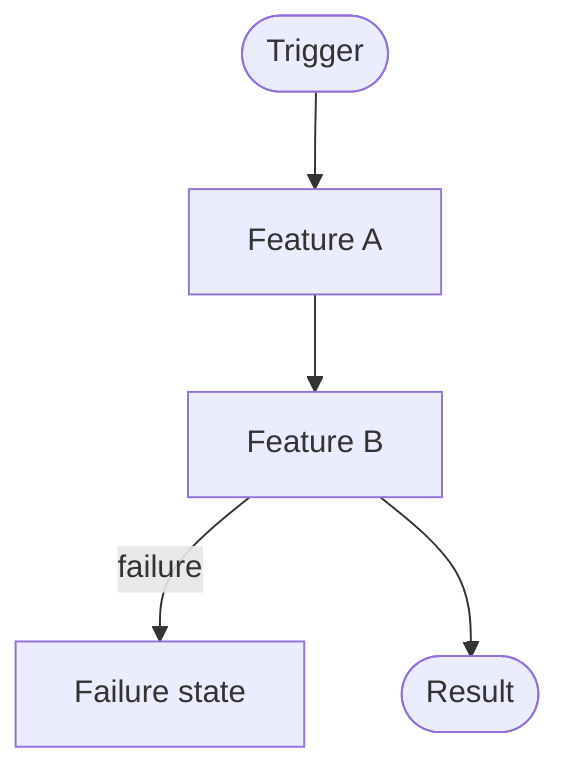
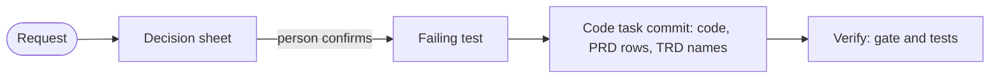

# End-to-end flow

The one overview of how the system runs, from trigger to result. Written by `/trd-create`; when the end-to-end flow changes, update this file: it is the single source of the overview, and other documents link here instead of drawing their own.

## How a rule change travels (size S and M)

The rows land in the PRD in the commit of the task that implements them. The commit body is the record (`Request:`, `Decided:`, `Assumed:`, `Red:`, then `Rules:`). There is no docs agent apply, no promote and no TRD Planned section; `docs/prd/CHANGELOG.md` is frozen and `gate.py --history <ID>` shows the history of a rule. Size L adds `plan.md` (waves) and `decisions.md`.

Legend: rounded nodes are external actors or systems; rectangles are features (`docs/trd/<feature>.md`); labeled edges are failure exits.
